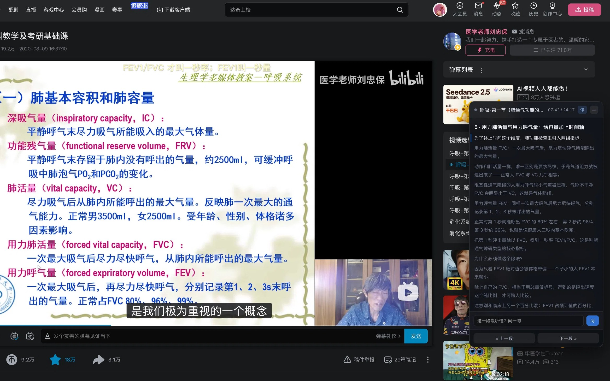

# dsh-listen-tutor · 听课助手

在 B 站视频页面上浮一块讲解面板：**播到哪，讲到哪**。它不是"看完给一份总结"，而是一份按播放进度排好的讲解稿，句子随播放器一句句点亮；没听懂可以直接在面板里问。

> 一个 DeepSeek Harness（DSH）插件。跑在 macOS + Safari 上。

<p align="center">
  
  <br>
  <sub>真实运行截图：B 站《生理学》第 27 讲。右下角那块就是讲解面板，跟着播放进度一句句点亮；底下输入框可以直接提问。</sub>
</p>

## 它和别的东西不一样在哪

大部分 B 站 AI 工具吃的是**字幕**：拿字幕去总结、去问答。这门课里最重要的信息往往不在字幕里——PPT 上那张图、那个表、那行公式，字幕一个字都不会提。

这个插件吃**画面**：它让页面里的 `<video>` 自己 seek 一遍，用低分辨率灰度指纹找出所有翻页时刻，再在那些时刻抓图。于是讲解稿可以做到"一页 PPT 一段"，写稿的人（或 agent）能看着那一页讲。

| | 吃字幕的工具 | 听课助手 |
| --- | --- | --- |
| 输入 | 字幕文本 | 字幕 + **PPT 画面** |
| 输出 | 一份总结 / 选中才讲 | **按页切好的讲解稿**，跟播放逐句推进 |
| 空白页 | 会漏（字幕没提） | 按页覆盖，一页不落 |
| 提问 | 需要 API key | 走本地 agent，不填 key |

## 长什么样

面板是页面右下角一张卡片：

- 顶部：集名、`当前时间 / 总时长`、收起按钮
- 中间：当前这一页的讲解，按句子拆开，讲到的句子亮起来，下面自动跟着滚
- 底部：「这一段没听懂？问一句」输入框 + 上一段/下一段

点面板上的段可以跳转；`«` `»` 直接切到上一页/下一页对应的时刻。面板自己每秒读 `video.currentTime`，**不发任何网络请求**。

## 安装

需要：macOS、Safari（并开启「开发」菜单下的 *允许 JavaScript 来自 Apple 事件*）、一个跑着的 DSH。

```bash
# 在 DSH 里
plugin_manager action=install_bundle target=/absolute/path/to/dsh-listen-tutor
```

装完刷新页面，去 B 站视频页，面板会自己出现。要临时藏起来点面板右上角。

> Safari 设置：`Safari → 设置 → 高级 → 显示网页开发者功能`，然后 `开发 → 允许 JavaScript`。
> 也可以命令行开：`defaults write com.apple.Safari AllowJavaScriptFromAppleEvents -bool true`。

## 怎么给它一份讲解稿

面板本身不生成文字——生成交给 DSH 里活着的 agent（也就是你在用的那个模型）。流程是这样：

1. 面板显示「这一集还没写讲解」时，点一下按钮（或直接在 DSH 里说一句"给这一集写讲解"）
2. 插件把当前集信息 + 字幕 + 已抓到的页图路径打包成一条消息，`agent.followup()` 推给 agent
3. agent 写好的 JSON 落到 `~/.dsh/listen-tutor/lessons/<key>.json`
4. **插件监听着这个目录**，文件一落地就热推进页面里的面板——不用刷新，不用重新注入

想批量做整门课，用这三步：

```bash
# 1. 扫出所有换页时刻（视频会自己 seek 一遍，几分钟）
curl -X POST localhost:65354/x-listen-tutor/scan

# 2. 看进度
curl 'localhost:65354/x-listen-tutor/scan-status'

# 3. 按这些时刻抓页图
curl 'localhost:65354/x-listen-tutor/scan-capture?ts=5,30,310,490'
```

页图落在 `~/.dsh/listen-tutor/slides/<key>/<序号>-<秒数×10>.jpeg`，格式 `003-3100.jpeg` = 第 3 张、视频第 310 秒。

## 原理

```
Safari (B站页面)                    DSH 宿主 (Node)
┌──────────────────┐                ┌─────────────────────┐
│ <video>          │◄──osascript────│ /scan /scan-capture │
│ 讲解面板 (注入)   │                │ /frame  /slides     │
│ window.__LT_PANEL│◄──变量信箱─────│ /state  /lesson     │
│ window.__LT_ASK  │───────►        │ /ask    /health     │
└──────────────────┘                └──────────┬──────────┘
                                               │ fs.watch
                                    ~/.dsh/listen-tutor/lessons/*.json
```

几个绕不过去的坑，都在代码里写了注释：

- **读后台标签**：用 `safari.windows()[w].tabs()[t]` 拿到 tab 对象再 `doJavaScript(code, {in: tab})`，前台切到别的网页也能读。
- **https 页面连不上 http 本地端口**：Safari 直接拦掉（`TypeError: Load failed`，跟 CORS 无关）。所以提问走"页面变量信箱"：面板只往 `window.__LT_ASK` 塞对象，宿主每 3 秒来取一次。
- **抓帧是黑的**：视频暂停 + 页面在后台标签时，seek 之后浏览器不解码那一帧，`canvas.drawImage` 出来的是一张纯黑。解法是先 `nudge` 一下（`currentTime += 0.04`）再抓，抓不到就重试 3 次，小于 25KB 的图当失败丢掉。
- **`doJavaScript` 里脚本报错不抛异常**，只返回空字符串。注入逻辑必须有返回值守卫，否则你会在"为什么没反应"里泡一下午。
- **改 host 不会自动重载**：`plugin_manager set_plugin ... enabled=false` 再 `true`。改 client 半要 ⌘Q 重启 App。

## 认一页 PPT 有多难

扫描阶段每 5 秒抽一张 24×14 的灰度图跟上一张比，变了就记时间点。问题是**它会把页内动画、老师右下角摄像头的小动作都当成换页**——96 分钟的课扫出 61 个"变化点"，而实际只有 28 页。

所以真正的分页还得看一眼图。抓下来的图按 sha256 去重后仍有 47 个 hash，因为这节课的老师在每页里逐条放动画。目前没做自动去重，靠人（或 agent）过一遍联系表。

想让它更聪明的话，可以试试：按 PPT 区域裁掉摄像头区再比、比之前先做形态学去噪、或者干脆用视觉模型分类。欢迎 PR。

## 暂停就停，播放再接着抓

按了暂停（或者播完），插件会把页面里那个换页看门狗整个停掉、也不再往磁盘搬页。你走开一小时回来，它一页没多抓。

判断靠的是 `video.paused`，跟心跳同一个节拍（3 秒）。停的时候只在宿主内存里记一笔，之后每轮只查内存、不碰页面——暂停期间不起任何 osascript。重新播放的那一轮会自动把看门狗装回去，页码接着磁盘上最大的那张往下编，不重抓也不漏。

面板本身不跟着消失：暂停时照样能往上翻页、看讲解、提问。

## 换集自动写稿

换到一集还没有讲解的视频，插件当场就抓字幕、请 agent 写这份稿子，写完面板自动换上，不用你动手。

同一集只自动写一次（失败过才放开重试）。同一时间只会写一篇，开好几个标签也不会把 agent 刷爆。不想要就把它关掉：

```bash
curl -X POST http://127.0.0.1:65354/x-listen-tutor/switch -d '{"autoLesson":false}'
```

手动要一份仍然是 `POST /x-listen-tutor/request-lesson`，不受这条限制。

## 开关

面板右上角有个小按钮，点一下整个插件就停了——不探测、不注入、不抓页，面板留在原处变灰，点「开」接着用。

命令行也能拨：

```bash
curl localhost:65354/x-listen-tutor/switch                        # 看状态
curl -X POST -H 'content-type: application/json' \
     -d '{"on":false}' localhost:65354/x-listen-tutor/switch       # 关
```

状态存在 `~/.dsh/listen-tutor/settings.json`，重启宿主也记得。

**浏览器没开的时候它什么都不做。** 心跳第一件事是 `pgrep -x Safari`——约 10 毫秒，不需要任何权限；
进程不在就直接返回。原来每 3 秒白起一个 osascript、问不到再吞个异常的日子过去了。

两个方向都能拨：面板点按钮 → 写 `window.__LT_SWITCH` → 心跳 3 秒内取走；
curl 拨 → 下次 `update()` 推给面板 → 面板自己变。关着的时候心跳不空转，但留了一条缝：
每 9 秒看一眼面板，好让你能从页面上把它拨回来。

## 路由

| 方法 | 路径 | 作用 |
| --- | --- | --- |
| GET | `/state` | 当前秒数、时长、暂停与否、集名、key、有没有稿 |
| GET | `/lesson?key=` | 某一集的讲解稿 |
| GET | `/lessons` | 所有已生成的稿 |
| GET | `/subtitle` | 当前集 AI 字幕（带时间戳） |
| POST | `/seek {t}` | 跳到第 t 秒 |
| POST | `/control {action}` | `play` / `pause` / `toggle` / `back15` / `fwd15` |
| POST | `/request-lesson` | 抓字幕存盘 + 推消息给 agent 写稿 |
| POST | `/inject` | 立刻往页面注入面板 |
| GET | `/panel` | 面板活着没、build 版本对不对 |
| GET | `/frame?w=&q=` | 抓一帧存盘 |
| GET | `/frames` | 列这一集抓过的帧 |
| GET | `/slides?drain=1` | 列/搬运页面里攒下的页图 |
| POST | `/scan` | 开始扫页 |
| GET | `/scan-status` | 扫描进度 / 命中点 |
| GET | `/scan-capture?ts=` | 按时刻抓页图 |
| POST | `/ask {q,t}` | 提问（宿主侧入口，面板走信箱） |
| GET | `/ask-status?id=` | 某个问题答了没 |
| GET | `/switch` | 开关状态 + 浏览器开着没 |
| POST | `/switch {on}` | 拨开关 |
| GET | `/health` | 自检 |

## 讲解稿格式

```json
{
  "key": "BV1va4y1J72r-mkwo98",
  "bvid": "BV1va4y1J72r",
  "ep": "循环-调节",
  "duration": 5768,
  "style": "per-slide",
  "segments": [
    {
      "t0": 4355,
      "t1": 4803,
      "title": "血管紧张素 II：四条功能",
      "body": "这一页的重点是……",
      "points": ["收缩血管平滑肌", "促醛固酮", "促交感末梢释放 NE"]
    }
  ]
}
```

`t0/t1` 必须首尾相接铺满整个视频，面板靠它判断"现在讲哪一段"。`style` 是给人看的标记，`per-slide` 表示按页切、`linear` 表示按时间切。

## 讲解稿的 key 怎么定

`<bvid>-<fnv1a(当前集标题)>`，比如 `BV1va4y1J72r-mkwo98`。

**不能只用 URL 里的 `?p=`**：B 站合集在播放器里切集是 SPA 换内容，地址栏经常带着旧的 `p` 或者干脆没有。只认 `p` 会让整个合集撞到同一份讲解稿。

## 已知限制

- **只有 Safari**。Chrome 用户得改 `PROBE_SCRIPT`（换成 CDP 或者 `osascript` 的 Chrome 方言）。
- **只有 B 站**。`shapeState()` 里 `/\/video\/(BV[0-9A-Za-z]+)/` 是写死的。
- **认页不自动化**。61 个变化点 → 28 页这一步现在靠人看图。
- **讲解稿要 agent 写**。插件不内置模型，也不存 API key。
- 一节课扫一遍大概 15 分钟，扫的时候视频画面会自己乱跳（扫完会回到原来位置）。
- 开关关着时，页面上那个面板不会自己消失（它本来就在页面内存里），只是停住不动。

## 样板

`BV1va4y1J72r` P24「循环-调节」——医学本科·生理学「心血管活动的调节」，96 分钟、28 页、7097 字讲解稿，提问链路实测通过。

## License

MIT

<!--
  彩蛋

  这个插件是从一个很具体的困惑开始的：一堂 96 分钟的课，
  老师在第 95 页 PPT 上讲了 20 分钟。用 dHash 找换页，
  这一页被拆成了 11 张指纹不同的图 —— 摄像头小窗里老师一直在动。

  后来学会的是不要相信元数据：
  别信 URL 里的 p 参数（合集切集时它不改）；
  别信 B 站给的 AI 字幕轨（P27 的字幕打开是一段 150 秒的汽车广告）；
  别信「保存成功」——Safari 的 doJavaScript 抛异常时不会 throw，
  只会安静地回一个空字符串，看起来跟成功一模一样。

  最后信画面。这个项目的每一段讲解，都是从一张 1280×720 的截图里读出来的。

  © muziwendui
-->
